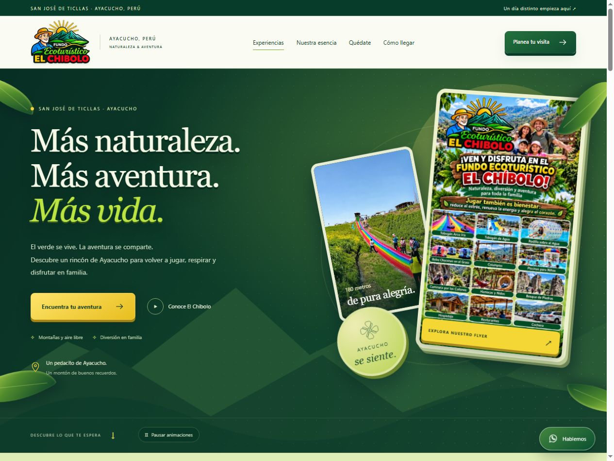

# Fundo Ecoturístico El Chibolo

Sitio web de El Chibolo, en San José de Ticllas, Ayacucho, Perú. Diseño responsive con colores de naturaleza, identidad visual del fundo, relieve 3D, catálogo de experiencias, galería, videos y consultas por WhatsApp.



El sitio utiliza HTML, CSS y JavaScript sin frameworks ni dependencias externas de código. Los videos y enlaces de contacto necesitan conexión a Internet.

## Ejecutar localmente

Puedes abrir `index.html` directamente en el navegador.

Para utilizar el servidor local, instala Node.js 20 o posterior y ejecuta desde esta carpeta:

```sh
npm start
```

Abre <http://127.0.0.1:4173>. Para detener el servidor, pulsa `Ctrl + C`. No necesitas ejecutar `npm install`.

Si tienes Node.js disponible sin npm, puedes usar directamente `node scripts/server.mjs`.

## Estructura

```text
el-chibolo-github/
├── index.html                 # Página principal, navegación y contenido
├── assets/
│   ├── css/
│   │   ├── style.css          # Maquetación y diseño responsive
│   │   └── nature.css         # Paleta de naturaleza y profundidad visual
│   ├── js/
│   │   ├── app.js             # Experiencias, filtros, videos y consultas
│   │   └── nature.js          # Inclinación con puntero y control de movimiento
│   └── images/                # Fotografías, logo, flyer y copias optimizadas
├── docs/
│   ├── FUENTES.md             # Procedencia y créditos de las imágenes
│   └── vista-previa.jpg       # Captura de referencia
├── scripts/
│   ├── server.mjs             # Servidor local para vista previa
│   └── check-assets.mjs       # Comprobación de rutas y recursos locales
├── package.json
├── .gitignore
├── .gitattributes
└── .editorconfig
```

## Editar el sitio

- **Contenido, contactos y enlaces principales:** `index.html`.
- **Actividades, tarifas e imágenes de las tarjetas:** arreglo `experiences` de `assets/js/app.js`.
- **Colores y efecto 3D:** `assets/css/nature.css` y `assets/js/nature.js`.
- **Diseño y distribución de las secciones:** `assets/css/style.css`.
- **Fotografías y archivos de marca:** `assets/images/`.

Las rutas son relativas, para que el sitio funcione tanto en la raíz de un dominio como dentro de un repositorio de GitHub Pages. No hay un paso de compilación: los archivos de este repositorio son los archivos del sitio.

## Verificar los archivos

```sh
npm run check
```

Este comando comprueba la sintaxis de JavaScript y verifica que existan las imágenes, estilos, scripts y destinos de navegación internos utilizados por la página.

También puedes comprobar los recursos con `node scripts/check-assets.mjs`.

## Subir a GitHub

Esta carpeta tiene un repositorio Git local con la rama `main` y los archivos preparados para el primer commit. Crea un repositorio vacío en tu cuenta de GitHub. Sustituye los valores de ejemplo por tu nombre, correo de GitHub, usuario y nombre del repositorio:

```sh
git config user.name "TU_NOMBRE"
git config user.email "TU_CORREO_DE_GITHUB"
git add .
git commit -m "Sitio web El Chibolo"
git remote add origin https://github.com/TU_USUARIO/TU_REPOSITORIO.git
git push -u origin main
```

Los comandos `git config` anteriores configuran la identidad solamente para este repositorio. Puedes usar tu dirección de correo `noreply` de GitHub.

Para guardar y subir cambios posteriores:

```sh
git add .
git commit -m "Actualizar sitio El Chibolo"
git push
```

Si trabajas desde el ZIP en otra computadora, primero crea el repositorio local:

```sh
git init -b main
git config user.name "TU_NOMBRE"
git config user.email "TU_CORREO_DE_GITHUB"
git add .
git commit -m "Sitio web El Chibolo"
```

Después añade el remoto y sube `main` con los comandos anteriores. Si Git solicita tu identidad, configura tu nombre y correo de GitHub antes del commit.

## Publicar el sitio

El repositorio es compatible con hosting estático. Para GitHub Pages, utiliza la rama `main` y la carpeta raíz del repositorio como origen. En otros servicios, publica la raíz, donde se encuentra `index.html`; no necesitas un comando de construcción.

Consulta [la documentación oficial de GitHub Pages](https://docs.github.com/en/pages/getting-started-with-github-pages/configuring-a-publishing-source-for-your-github-pages-site) para configurar la publicación.

## Funciones y contenido

- Ocho experiencias con filtros por categoría.
- Logo, flyer y fotografías locales; copias WebP para la portada.
- Video principal: <https://www.youtube.com/watch?v=nxwpxp4neOM>.
- Galería y flyer ampliables.
- Efecto 3D con puntero, pausa de movimiento y respeto por `prefers-reduced-motion`.
- Menú adaptable a dispositivos móviles.
- Formulario que prepara una consulta por WhatsApp. La reserva se confirma directamente con El Chibolo.

Los teléfonos del fundo son **942 468 851** y **929 517 122**. La información de actividades y tarifas es referencial y procede de la página original del negocio; debe actualizarse cuando cambien sus condiciones.

## Fuentes y derechos

Información del negocio: [página original de El Chibolo](https://ranamizekazora.sitew.org/EL-CHIBOLO.a.htm), consultada el 13 de octubre de 2026.

Las fotografías del destino proceden de [Car Wari](https://car-wari.com/destinations/32), publicaciones públicas de [Ecoturismo El Chíbolo](https://www.facebook.com/TicllasAyacucho) y miniaturas o fotogramas de sus videos enlazados. Los créditos de Facebook se detallan en [docs/FUENTES.md](docs/FUENTES.md). El logo y flyer fueron proporcionados por el usuario; sus PNG originales se conservan junto con las versiones optimizadas.

Las imágenes y la marca conservan los derechos de sus respectivos autores. Este repositorio no les asigna una licencia abierta. Para publicación comercial, confirma autorización para las fotografías de terceros o sustitúyelas por imágenes propias.
